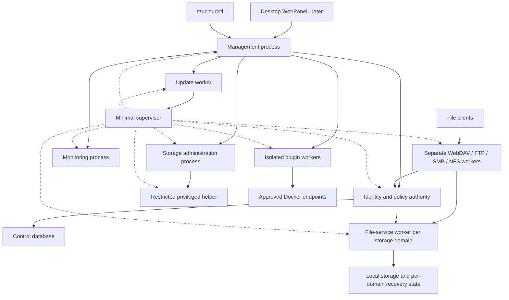

# Backend architecture

[简体中文](architecture.zh-CN.md) · [Documentation](README.md) · [Protocol plan](protocols.md)

Status: proposed design. Component names, paths, and API routes below are planned contracts, not existing code.

## 1. Product boundary

tauCloud is a single-host, user-space NAS/private cloud service. It manages configured directories on existing filesystems and exposes them through native protocol servers. It also monitors the host and manages explicitly enabled integrations. It does not own the host operating system, require reformatting disks, or implement a new filesystem.

Use a supervised multi-process backend on one host from the first executable milestone. Separate failure domains while keeping one shared set of service contracts. Libraries are implementation units; processes are deployment and fault-isolation units. The desktop-style WebPanel is an independent API client, with no dependency from backend targets to frontend tooling.



Solid arrows show service calls and dotted arrows show supervision. PACE runs independently inside each network/IPC worker. File payloads flow through bounded protocol-to-file-service channels, never through the management API, supervisor or metadata database. Host administrators and applications accessing the underlying directories can bypass tauCloud; those limits are part of the security model.

### Process ownership and failure domains

| Process | Owns | Failure boundary |
| --- | --- | --- |
| Supervisor | Process identities, generations, startup graph, restart budgets | Restarting it must not automatically kill healthy children; reconcile and adopt only verified generations |
| Management | HTTPS API, API sessions, frontend assets | UI/API outage; file clients do not traverse this process |
| Identity/policy authority | Users, grants, credential providers, control database writer | New authentication/configuration pauses; existing access expires at bounded policy leases |
| Protocol worker per family | Listener, wire sessions, protocol state | A failed family disconnects its own clients; siblings continue |
| File-service worker per storage domain | Native handles, locks, quota reservations, local recovery journal | A failed domain affects every protocol using it, but unrelated volumes continue |
| Monitoring | Sampling, health rules and metrics retention | Telemetry becomes stale; file serving continues |
| Storage administration + helper | Storage plans/jobs and narrowly privileged OS actions | Mutations pause/reconcile; existing kernel storage may continue operating |
| Plugin worker per plugin | Integration state, including Docker | Only that integration becomes unavailable |
| Update worker | Download/verification/staging and durable upgrade workflow | Existing versions remain running until an authorized switch |

A storage domain initially follows a volume/filesystem, with all overlapping roots assigned to the same owner. This preserves one lock/quota authority for a file without turning every volume into one failure domain. The identity authority is logically shared; there is no claim of host-level high availability. OOM, kernel faults, power loss and shared dependencies can still affect several services.

The OS service manager starts a small supervisor. Each child has separate resource budgets, logs, readiness, heartbeat, restart backoff and a crash-loop limit. Do not restart siblings on one worker failure. Readiness/dependency failures put only affected operations into a degraded state. Authentication-provider work belongs to the identity service, not an implicitly trusted protocol caller.

### IPC and recovery contract

Use authenticated local IPC: Unix-domain sockets on Linux and ACL-protected named pipes on Windows, with PACE-compatible nonblocking adapters. Separate bounded control messages from bounded file-transfer streams. Version the envelope and include caller identity, request ID, deadline, cancellation, resource ID and generation. Bound frames, queue depth and in-flight bytes; disconnect slow or invalid peers. Shared-memory optimization comes only after measurement and an ownership review.

Protocol workers obtain scoped, short-lived access grants from the identity authority; file workers validate them and enforce policy, quotas and locks. Push revocation with acknowledgements and use bounded lease expiry as the fallback. If the authority is unreachable, deny new authentication and stop file operations when cached grants expire. A grant change is reported effective only after relevant workers acknowledge it or old leases expire. Never fail open indefinitely.

The authority alone writes the control SQLite database. Each storage domain owns a separate recovery/state database; monitoring and update journals have their own owners. Exchange versioned records/events over IPC instead of sharing SQLite files among unrelated processes. Cross-service mutations use durable intent, idempotency keys and reconciliation; there is no imaginary transaction across these databases and the filesystem.

On protocol-worker loss, fence its generation and drain outstanding file operations before releasing its locks/reservations. On file-worker loss, invalidate handles and reject stale-generation requests; reconnect/reclaim follows each protocol's contract. Never blindly replay a non-idempotent write after an IPC timeout: query the operation record or report an uncertain result. Storage ownership is exclusive; two generations must never serve the same domain concurrently. See [operations](operations.md) for upgrades and failure tests.

## 2. Components and dependency rules

| Component | Responsibility |
| --- | --- |
| `core` | IDs, errors, clocks, capability descriptions, configuration schemas |
| `runtime` | PACE integration, admission limits, task lifetime, bounded blocking executor |
| `identity` | Users, groups, credentials, sessions, protocol identity mapping |
| `policy` | Authorization decisions, grants, revocation, management roles |
| `storage` | Spaces, root handles, file operations, quota accounting, locks, file IDs |
| `metadata` | SQLite transactions, migrations, configuration and recovery records |
| `protocols/*` | Wire codecs, per-connection state, negotiation, protocol-specific errors |
| `api` | Versioned management endpoints and event delivery |
| `jobs` | Durable background jobs, progress, cancellation and restart recovery |
| `monitoring` | Host collectors, sampling, health rules, bounded retention |
| `platform` | Linux/Windows filesystem, service, credential-store and host adapters |
| `plugins` | Manifest validation, versioned IPC, permissions and process supervision |
| `ipc`, `supervisor` | Authenticated service contracts, process ownership and restart/recovery |
| `updates`, `storage_admin` | Component upgrade plans and native disk/RAID management |

Protocol modules depend on IPC service clients, not on one another. Shared core libraries define types and algorithms, not duplicate policy/lock authorities in each process. `storage` must not understand HTTP responses or SMB packets. HTTP handlers and the CLI use application services rather than issuing ad hoc SQL. OS calls stay behind platform interfaces. Production adapters and test doubles implement the same contracts.

Use build-time selection for first-party protocol modules initially. Do not introduce a public C++ plugin ABI: compiler, standard-library and allocator differences would become compatibility constraints.

## 3. PACE integration and execution

The [inspected PACE baseline](README.md) provides coroutine tasks, explicit worker contexts, TCP/UDP, TLS, HTTP and WebSocket modules. Its documented Windows backend uses WSAPoll, not IOCP. It does not expose a portable asynchronous file API or a blocking-work executor. See the upstream [architecture](https://github.com/TabNahida/PACE/blob/d3842473b2bea63e291eb25fe44f610cbd49b02e/docs/architecture.md) and [platform reference](https://github.com/TabNahida/PACE/blob/d3842473b2bea63e291eb25fe44f610cbd49b02e/docs/reference/platform.md).

Proposed execution rules:

- Each connection has an owning PACE context. Network handles, coroutine lifetimes and buffers remain valid until their operations finish.
- Keep disk access, SQLite work, password hashing, host commands and expensive parsing off network event loops. Use a bounded blocking executor; return results to the owning context through a lifetime-safe completion bridge.
- Bound connection count, queued operations, bytes in flight, directory results, per-user concurrency and background work. Overload rejects or pauses work instead of allocating without limit.
- Prototype a portable single acceptor per listener before adding platform-specific distribution. Do not assume Linux listener reuse exists on Windows.
- Isolate expected client/protocol failures from runtime-level exceptions. Track connection tasks explicitly so shutdown can drain them.
- Stop accepting, reject new jobs, cancel/drain active work, flush required state, join blocking workers, then stop/join PACE and release contexts. Timeout or process interruption marks unfinished work for recovery; cancellation alone cannot undo a completed file write.

### HTTP work required before file delivery

PACE currently buffers accepted request bodies; response streaming uses a synchronous producer. Its HTTP/1 interface also rejects `Expect: 100-continue`. See the [HTTP reference](https://github.com/TabNahida/PACE/blob/d3842473b2bea63e291eb25fe44f610cbd49b02e/docs/reference/http.md).

Small JSON management requests can use bounded buffering. WebDAV and general file uploads require incremental request consumption, asynchronous response production, admission before body consumption, backpressure, disconnect cancellation, and tested `100-continue` handling. M0 defines the interface and M3 requires the implementation. Prefer focused upstream PACE additions; keep tauCloud-specific authorization outside PACE. Increasing a body-size cap is not the large-file solution.

Link only the required PACE modules: runtime/networking, HTTP/1, TLS, and later WebSocket. HTTP/2 is optional; HTTP/3/QUIC is outside the first release. Pin a tested commit and dependencies rather than following a moving branch. The adjacent local checkout is a development convenience, not a build prerequisite.

## 4. Identity and storage model

| Entity | Meaning |
| --- | --- |
| `User`, `Group`, `Membership` | Stable application identities independent of OS usernames |
| `Credential`, `Session` | Separate password, SMB credential and session records |
| `StorageRoot` | Explicitly registered native root, stable identity and filesystem capabilities |
| `Space` | Private or team namespace backed by a directory within one root |
| `Share` | A view of a space/subtree with protocol exposure and access policy |
| `Grant` | Subject, resource and allowed action set; no grant means no access |
| `QuotaPolicy` | Subject/space budget, reservations, usage and enforcement strength |
| `ProtocolEndpoint` | Listener, enabled versions, network policy and status |
| `Job`, `AuditEvent` | Recoverable operation state and attributable activity |
| `PluginInstallation`, `EngineEndpoint` | Extension version/permissions and container connection |

A private space starts with access for its owner only. A team space uses explicit group grants. Management roles (`administrator`, `operator`, `member`) govern administrative actions separately from file grants. An administrator's ability to change grants is audited; administrative status is not an undocumented file-read bypass.

Initially require distinct space directories without overlapping ownership. Multiple shares may intentionally expose the same space, but must retain its authorization boundary and charge quota once to that space. Reject root/space aliases that could expose private files through another namespace; account for hard links and bind mounts during registration rather than relying only on pathname differences.

The initial portable policy is share/subtree based, with explicit actions such as list, read, create, overwrite, delete and manage grants. Do not claim full equivalence between Windows DACLs, POSIX ACLs and NFSv4 ACLs. Rich per-file ACL translation needs a later feature contract. Effective access must satisfy tauCloud policy and the permissions of the backend's native file operation; a service account does not inherit the end user's OS identity automatically.

### File service invariants

1. Resolve a space/share plus relative path against an authorized root handle. Reject traversal, ambiguous encodings, Windows device paths/alternate streams and links that escape the root. String-prefix checks are insufficient.
2. Use opaque file handles carrying root identity, object identity, access rights and generation. Rename must not silently retarget an open object; stale/reused IDs must not expose another file.
3. Route all native protocol mutations through common authorization, quota reservation, lock/share-mode checks and native I/O.
4. Keep a shared open/lock coordinator for byte ranges, delete/rename restrictions and protocol-specific ownership. Preserve each protocol's semantics; a WebDAV lock is not automatically an SMB lease. Disable optional caching/delegations until invalidation is proven.
5. Treat cross-protocol writable sharing as a separately tested capability. Initially allow one writable protocol per share; additional protocols may be read-only only when cache invalidation is safe, otherwise reject the combination.
6. Keep file sizes and offsets 64-bit. Support partial I/O, disk-full errors, short writes, flush and disconnects without claiming completion prematurely.

Use staged temporary files plus same-filesystem replace for whole-file uploads where semantics allow. Random-access SMB/NFS writes follow their protocol's visibility and durability rules; they cannot all be hidden behind atomic upload replacement. Explicitly distinguish accepted writes, flushed writes and durable metadata. Cross-volume moves are copy/delete jobs with partial-failure handling, not atomic renames.

### Accounting and persistence

SQLite is the proposed local metadata store, with serialized writes, migrations and supported online backups. Keep it on local storage. File data remains ordinary files; the database is not a second copy of their contents. Persist identities, grants, configuration, jobs, audit references and necessary recovery state.

Filesystem mutations and database commits are not one atomic transaction. Record operation intent, perform idempotent steps, commit results and reconcile interrupted work on startup. Protocol recovery journals, stable file IDs and NFS replay/reclaim state need protocol-specific designs; one generic job table is not sufficient.

Reserve quota before admitting writes and reconcile after completion/failure. A tauCloud-enforced quota covers mediated writes only; host applications can bypass it. Report `native_hard`, `service_enforced`, `advisory` or `unavailable` instead of presenting all quotas as hard limits. Snapshots and recycle bins are not backups; metadata backup and file-data backup are separate workflows.

## 5. Management API and frontend boundary

Use HTTPS JSON under `/api/v1`, with an OpenAPI contract delivered alongside implementation. CLI and future WebPanel call the same API. No frontend build is needed to build, test or run the backend.

| Planned resource | Operations |
| --- | --- |
| `/health/live`, `/health/ready` | Minimal liveness/readiness without private details |
| `/api/v1/auth/*` | Bootstrap status, login/logout, session and credential lifecycle |
| `/api/v1/users`, `/groups` | Identities, memberships and role assignment |
| `/api/v1/storage-roots`, `/spaces`, `/shares` | Storage registration, namespaces and policy |
| `/api/v1/protocols`, `/capabilities` | Listener configuration and effective support |
| `/api/v1/system`, `/disks`, `/metrics` | Host inventory, telemetry and health |
| `/api/v1/jobs`, `/audit-events` | Long-running operations and history |
| `/api/v1/plugins`, `/engines` | Extension and container integration management |
| `/api/v1/services`, `/updates` | Process health, versions, update plans and recovery |
| `/api/v1/storage-pools`, `/arrays`, `/volumes`, `/storage-plans` | Native storage inventory and preview/execute jobs |
| `/api/v1/desktop/preferences` | Per-user desktop layout and preferences |

In the table, abbreviated resource names retain the `/api/v1` prefix. Resource IDs are opaque. Separate file-transfer routes from administrative JSON endpoints; do not carry large binary data in JSON.

Use cursor pagination, bounded filters, UTC timestamps, structured errors (`code`, `message`, `request_id`, safe `details`), and resource revisions for conflicting updates. Return `202` plus a job ID for long work. Define idempotency keys for retryable mutations. Jobs expose queued/running/succeeded/failed/cancel-requested/cancelled states and recovery outcomes; cancellation is best effort.

Begin with polling for jobs and metrics. Add authenticated WebSocket events with bounded queues, sequence IDs and a resync path after gaps. API versioning and plugin IPC versioning are separate. The future WebPanel derives controls from capabilities rather than assuming all hosts implement every feature.

## 6. Proposed repository and build layout

```text
apps/taucloud-supervisor/   Host service and child supervision
apps/taucloud-api/          Management API and static WebPanel assets
apps/taucloud-identity/     Identity/policy authority and control DB
apps/taucloud-file/         One instance per storage domain
apps/taucloud-protocol/     Separate selected-family worker instances
apps/taucloud-monitor/      Monitoring and health rules
apps/taucloud-storage/      Disk/RAID administration jobs
apps/taucloud-updater/      Verified online upgrade workflow
apps/taucloudctl/           API client and local bootstrap command
apps/taucloud-helper/       Restricted privileged operations
include/taucloud/           Service contracts
src/{core,runtime,identity,policy,storage,metadata,api,jobs,monitoring}/
src/protocols/{webdav,ftp,smb,nfs,rpc}/
src/platform/{linux,windows}/
src/plugins/               Supervisor and IPC
src/{ipc,supervisor,updates,storage_admin}/
plugins/docker/            First-party application integration
api/openapi/               Management contract
schemas/                   Configuration and plugin schemas
tests/{unit,integration,interop,fuzz,recovery}/
packaging/{linux,windows}/
web/                       Independent WebPanel, added later
docs/                      English and Simplified Chinese design
xmake.lua                  Backend target graph, added in M1
```

Build separate libraries per component and protocol, then link only what each process requires. A shared protocol-worker executable may select one family per invocation; production families still run in separate processes. `core` stays small; protocol targets must not pull in frontend tools. Make protocol toggles independent, namespace project options to avoid PACE option collisions, and keep tests/examples opt-in for dependency builds.

Initial validation targets Linux x86-64 with GCC and Clang, and Windows x86-64 with MSVC. M0 pins exact compiler, SDK, xmake and OS versions. Add ARM64 only after native functional evidence. Use warnings, sanitizers where supported, parser fuzzing and real-host protocol tests; successful compilation alone is not protocol support.
