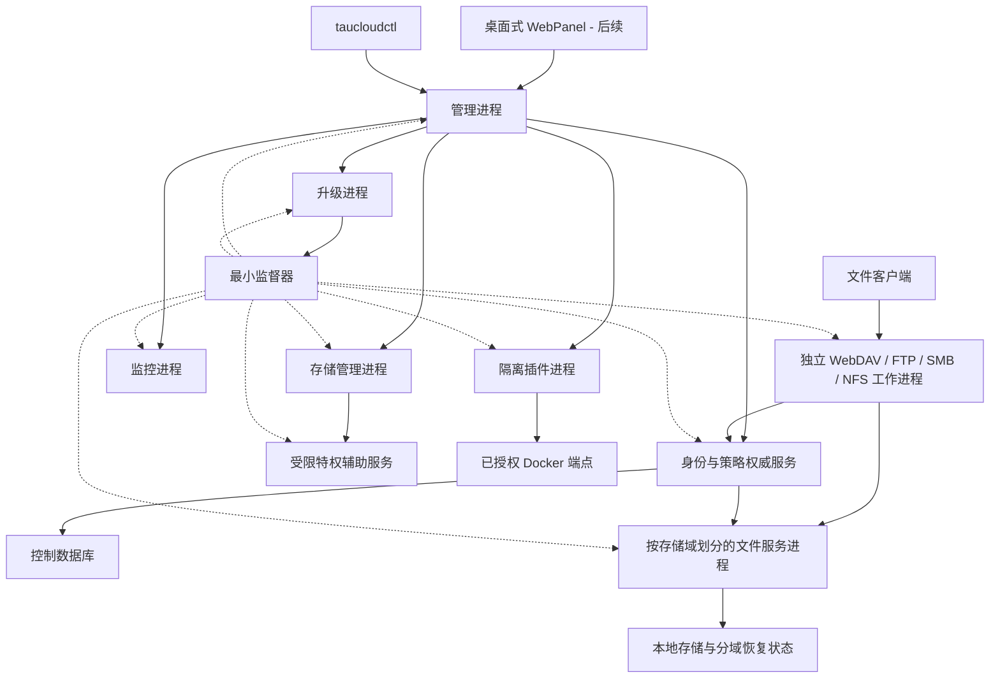

# 后端架构

[English](architecture.md) · [文档](README.zh-CN.md) · [协议规划](protocols.zh-CN.md)

状态：建议设计。下文组件名称、路径和 API 路由都是拟定契约，不代表已经存在代码。

## 1. 产品边界

tauCloud 是单机、用户态 NAS 与私人云服务。它管理已有文件系统中的指定目录，通过原生协议服务器对外提供访问，同时监控宿主并管理显式启用的集成。它不接管宿主操作系统，不要求重新格式化硬盘，也不实现新文件系统。

从首个可执行里程碑开始，采用单机受监督的多进程后端。按故障域隔离，同时保留统一的服务契约。库是实现单元，进程是部署和故障隔离单元。桌面式 WebPanel 是独立 API 客户端，后端构建目标不依赖前端工具链。



实线表示服务调用，虚线表示监督关系。各网络与 IPC 工作进程独立运行 PACE。文件内容通过协议与文件服务之间的有界通道传输，不经过管理 API、监督器或元数据数据库。宿主管理员以及直接访问底层目录的程序可以绕过 tauCloud，这属于安全模型的边界。

### 进程所有权与故障域

| 进程 | 拥有的状态 | 故障边界 |
| --- | --- | --- |
| 监督器 | 进程身份、代次、启动图和重启预算 | 自身重启不自动杀死健康子进程；核对并接管已验证代次 |
| 管理服务 | HTTPS API、API 会话、前端静态资源 | 界面/API 中断；文件客户端不经过此进程 |
| 身份与策略权威服务 | 用户、授权、认证提供者、控制数据库写入 | 暂停新认证与配置；已有访问受有界策略租约限制 |
| 各协议工作进程 | 监听器、网络会话、协议状态 | 某协议故障断开自身客户端，其他协议继续运行 |
| 各存储域文件服务进程 | 原生句柄、锁、配额预留、本地恢复日志 | 故障影响访问该域的全部协议，其他卷继续运行 |
| 监控 | 采样、健康规则和指标保留 | 遥测过期，文件服务继续运行 |
| 存储管理与辅助服务 | 存储计划/任务和狭窄的系统特权操作 | 变更暂停或协调恢复，内核已有存储可继续运行 |
| 各插件进程 | 集成状态，包括 Docker | 仅对应集成不可用 |
| 升级进程 | 下载/验证/暂存与持久化升级流程 | 批准切换前，原有版本继续运行 |

存储域初期按卷或文件系统划分，所有重叠根目录必须归属同一所有者。这样每个文件只有一个锁与配额权威节点，同时不同卷不会全部变成同一个故障域。身份服务在逻辑上共享，不宣称宿主级高可用。OOM、内核故障、掉电和共享依赖仍可能影响多个服务。

操作系统服务管理器启动精简监督器。每个子进程具有独立资源预算、日志、就绪状态、心跳、重启退避和崩溃循环上限。不能因单个工作进程失败而重启其他进程。就绪或依赖失败时，仅相关操作进入降级状态。认证提供者逻辑属于身份服务，不能默认信任协议进程上报的身份。

### IPC 与恢复契约

采用经过认证的本地 IPC：Linux 使用 Unix-domain socket，Windows 使用 ACL 保护的命名管道，并提供适配 PACE 的非阻塞接口。有界控制消息与有界文件数据流分开。消息封装版本化，包含调用方身份、请求 ID、截止时间、取消、资源 ID 与代次。限制帧长、队列深度和在途字节数，断开过慢或无效对端。共享内存仅在测量和所有权评审后作为优化。

协议进程从身份权威服务取得限定作用域的短期访问授权，文件进程验证授权并执行策略、配额与锁。撤销通过推送与确认完成，以有界租约到期兜底。身份服务不可达时拒绝新认证，缓存授权到期后停止文件操作。授权修改只有在相关进程确认或旧租约到期后才能报告生效，不能无限期放行。

仅权威服务写入控制 SQLite 数据库。各存储域拥有独立恢复/状态数据库，监控与升级日志也各有所有者。通过版本化记录和事件交换状态，不让无关进程共享写入 SQLite 文件。跨服务变更使用持久化意图、幂等键与协调恢复，不假设数据库与文件系统之间存在统一原子事务。

协议进程失联时，先隔离其代次，排空未完成文件操作，再释放对应锁与预留。文件进程丢失时，使句柄失效并拒绝旧代次请求；重连或 reclaim 遵守协议契约。IPC 超时后不能盲目重放非幂等写入，应查询操作记录或报告结果不确定。存储所有权必须独占，两个代次不能同时服务同一域。升级与故障测试见[运维设计](operations.zh-CN.md)。

## 2. 组件与依赖规则

| 组件 | 职责 |
| --- | --- |
| `core` | ID、错误、时钟、能力描述与配置结构 |
| `runtime` | PACE 集成、准入限制、任务生命周期和有界阻塞执行器 |
| `identity` | 用户、组、凭据、会话与协议身份映射 |
| `policy` | 授权决策、授权项、撤销和管理角色 |
| `storage` | 空间、根句柄、文件操作、配额记账、锁与文件 ID |
| `metadata` | SQLite 事务、迁移、配置与恢复记录 |
| `protocols/*` | 网络编解码、连接状态、协商与协议错误映射 |
| `api` | 版本化管理端点和事件传递 |
| `jobs` | 持久化后台任务、进度、取消和重启恢复 |
| `monitoring` | 宿主采集器、采样、健康规则与有界保留 |
| `platform` | Linux/Windows 文件系统、服务、凭据存储与宿主适配 |
| `plugins` | 清单验证、版本化 IPC、权限与进程监督 |
| `ipc`、`supervisor` | 已认证服务契约、进程所有权与重启恢复 |
| `updates`、`storage_admin` | 组件升级计划与原生硬盘/RAID 管理 |

协议模块依赖 IPC 服务客户端，不相互依赖。共享核心库定义类型和算法，不能在每个进程中复制一份策略或锁权威状态。`storage` 不应理解 HTTP 响应或 SMB 报文。HTTP 处理器与 CLI 通过应用服务工作，不自行拼接 SQL。操作系统调用集中在平台接口后面。生产适配器与测试替身实现相同契约。

初期以构建选项选择第一方协议模块。不引入公开 C++ 插件 ABI，避免编译器、标准库和分配器差异变成兼容性负担。

## 3. PACE 集成与执行模型

[本次查看的 PACE 基线](README.zh-CN.md) 提供协程任务、显式工作上下文、TCP/UDP、TLS、HTTP 和 WebSocket 模块。其 Windows 后端使用 WSAPoll，而非 IOCP；目前没有通用异步文件 API 或阻塞任务执行器。依据为上游[架构](https://github.com/TabNahida/PACE/blob/d3842473b2bea63e291eb25fe44f610cbd49b02e/docs/architecture.md)与[平台说明](https://github.com/TabNahida/PACE/blob/d3842473b2bea63e291eb25fe44f610cbd49b02e/docs/reference/platform.md)。

建议执行规则：

- 每个连接归属一个 PACE 上下文。网络句柄、协程和缓冲区必须存活至对应操作完成。
- 磁盘访问、SQLite、密码哈希、宿主命令和高成本解析不能阻塞网络事件循环。使用有界阻塞执行器，并通过生命周期安全的完成桥接回到所属上下文。
- 限制连接数、排队操作数、在途字节数、目录结果数、每用户并发和后台任务量。过载时拒绝或暂停任务，不能无限分配资源。
- 先验证每个监听器一个 acceptor 的可移植方案，再优化平台相关的连接分配。不假设 Windows 具备 Linux 的监听端口复用方式。
- 将可预期的客户端与协议错误隔离在连接边界内，显式跟踪连接任务，以便退出时等待其完成。
- 停止接入、拒绝新任务、取消或排空活动操作、刷写必要状态、等待阻塞线程完成，再停止并等待 PACE，最后释放上下文。超时或进程中断时标记未完成任务供恢复；取消不能撤销已经完成的文件写入。

### 文件传输前必须补齐的 HTTP 能力

PACE 当前缓冲已接受的请求体；响应流式接口使用同步生产者；HTTP/1 接口还会拒绝 `Expect: 100-continue`。见 [HTTP 参考](https://github.com/TabNahida/PACE/blob/d3842473b2bea63e291eb25fe44f610cbd49b02e/docs/reference/http.md)。

小型 JSON 管理请求可以使用有界缓冲。WebDAV 和通用文件上传需要增量请求消费、异步响应生产、读取请求体前的准入、背压、断线取消和经过验证的 `100-continue` 支持。M0 确定接口，M3 要求完成实现。优先向 PACE 增加聚焦的通用能力，tauCloud 授权逻辑留在应用层。简单提高请求体大小上限不能解决大文件问题。

仅链接需要的 PACE 模块：运行时、网络、HTTP/1、TLS，以及后续的 WebSocket。HTTP/2 可选；HTTP/3/QUIC 不在首版范围内。固定经过测试的提交及依赖，不跟随浮动分支。相邻本地仓库只是开发便利条件，不是构建前提。

## 4. 身份与存储模型

| 实体 | 含义 |
| --- | --- |
| `User`、`Group`、`Membership` | 独立于操作系统用户名的稳定应用身份 |
| `Credential`、`Session` | 分离保存密码、SMB 凭据和会话记录 |
| `StorageRoot` | 显式注册的原生根目录、稳定身份和文件系统能力 |
| `Space` | 位于一个存储根内的私人或团队目录命名空间 |
| `Share` | 空间或子树的视图，附带协议暴露与访问策略 |
| `Grant` | 主体、资源与允许的动作集合；无授权即无访问 |
| `QuotaPolicy` | 主体或空间预算、预留、用量与强制程度 |
| `ProtocolEndpoint` | 监听器、启用版本、网络策略和状态 |
| `Job`、`AuditEvent` | 可恢复操作状态和可归属的活动 |
| `PluginInstallation`、`EngineEndpoint` | 扩展版本与权限，以及容器连接 |

私人空间初始只允许所有者访问；团队空间通过用户组显式授权。管理角色（`administrator`、`operator`、`member`）与文件授权分开。管理员修改授权的行为需要审计；管理身份不能成为未说明的文件读取旁路。

初期要求不同空间目录的所有权范围不重叠。多个共享可以有意暴露同一空间，但必须保留该空间的授权边界，并且仅向该空间记账一次。拒绝可能通过另一命名空间暴露私人文件的根目录或空间别名；注册时考虑硬链接和 bind mount，不能仅凭路径字符串不同判断隔离。

初始可移植权限模型基于共享和子树，动作包括列出、读取、创建、覆盖、删除和管理授权。不宣称 Windows DACL、POSIX ACL 与 NFSv4 ACL 完全等价。丰富的逐文件 ACL 转换需要后续独立契约。有效访问必须同时满足 tauCloud 策略与后端原生文件操作的权限；服务账户不会自动继承最终用户的操作系统身份。

### 文件服务不变量

1. 将空间或共享与相对路径解析到已授权的根句柄。拒绝目录穿越、歧义编码、Windows 设备路径和备用数据流，以及逃逸根目录的链接。字符串前缀检查不足以保证安全。
2. 使用携带根身份、对象身份、访问权限和代次的不透明文件句柄。重命名不能悄悄改变已打开对象；过期或复用的 ID 不能指向另一文件。
3. 所有原生协议写操作都经过统一的授权、配额预留、锁与共享模式检查和原生 I/O。
4. 共享打开与锁协调器统一处理字节范围、删除或重命名限制，以及协议专属所有权。保留各协议语义；WebDAV 锁不自动等于 SMB lease。缓存失效正确性未验证前，不启用可选缓存或 delegation。
5. 多协议同时可写是单独验收的能力。初期每个共享只允许一个可写协议；只有缓存失效安全时才允许其他协议只读，否则拒绝该组合。
6. 文件大小和偏移使用 64 位。正确处理部分 I/O、磁盘满、短写、刷写和断线，不能过早报告完成。

完整文件上传在语义允许时采用临时文件加同文件系统替换。SMB/NFS 随机写遵守各自的可见性与持久性语义，不能全部包装成原子上传替换。明确区分已接受写入、已刷写和元数据持久化。跨卷移动是具有部分失败处理的复制与删除任务，不是原子重命名。

### 记账与持久化

建议使用 SQLite 保存本地元数据，串行化写入，提供迁移和受支持的在线备份。数据库置于本地存储。文件内容仍是普通文件，数据库不保存第二份内容。持久化身份、授权、配置、任务、审计引用和必要恢复状态。

文件系统变更和数据库提交不是同一原子事务。先记录操作意图，再执行幂等步骤、提交结果，并在启动时协调未完成操作。协议恢复日志、稳定文件 ID 与 NFS 重放或 reclaim 状态需要专门设计，一个通用任务表不足以覆盖。

写入准入前预留配额，完成或失败后核对。tauCloud 强制的配额仅覆盖经过自身的写入，宿主程序可以绕过。报告 `native_hard`、`service_enforced`、`advisory` 或 `unavailable`，不能将所有配额显示为硬限制。快照和回收站不是备份；元数据备份与文件数据备份是不同流程。

## 5. 管理 API 与前端边界

使用 `/api/v1` 下的 HTTPS JSON API，实施时同步交付 OpenAPI 契约。CLI 和未来 WebPanel 使用同一套 API。构建、测试和运行后端不需要前端构建。

| 拟定资源 | 操作 |
| --- | --- |
| `/health/live`、`/health/ready` | 不泄露私有信息的最小存活与就绪检查 |
| `/api/v1/auth/*` | 初始化状态、登录与登出、会话和凭据生命周期 |
| `/api/v1/users`、`/groups` | 身份、组成员和角色分配 |
| `/api/v1/storage-roots`、`/spaces`、`/shares` | 存储注册、命名空间与策略 |
| `/api/v1/protocols`、`/capabilities` | 监听配置与实际支持情况 |
| `/api/v1/system`、`/disks`、`/metrics` | 宿主清单、遥测和健康情况 |
| `/api/v1/jobs`、`/audit-events` | 长任务与历史记录 |
| `/api/v1/plugins`、`/engines` | 扩展和容器集成管理 |
| `/api/v1/services`、`/updates` | 进程健康、版本、升级计划与恢复 |
| `/api/v1/storage-pools`、`/arrays`、`/volumes`、`/storage-plans` | 原生存储清单与预览/执行任务 |
| `/api/v1/desktop/preferences` | 每用户桌面布局与偏好 |

表内缩写资源均保留 `/api/v1` 前缀。资源 ID 不透明。文件传输路由与管理 JSON 端点分开，不在 JSON 中传输大体积二进制数据。

采用游标分页、有界过滤、UTC 时间、结构化错误（`code`、`message`、`request_id`、安全的 `details`）以及用于处理更新冲突的资源修订号。长操作返回 `202` 和任务 ID。可重试变更定义幂等键。任务暴露 queued/running/succeeded/failed/cancel-requested/cancelled 状态与恢复结果；取消为尽力而为。

先通过轮询提供任务与指标，之后加入经过认证的 WebSocket 事件，限制队列大小，携带序列 ID，并在出现间隙后允许重新同步。API 与插件 IPC 独立版本化。未来 WebPanel 根据能力显示控件，不能假设所有宿主具有全部功能。

## 6. 拟定仓库与构建布局

```text
apps/taucloud-supervisor/   宿主服务与子进程监督
apps/taucloud-api/          管理 API 与 WebPanel 静态资源
apps/taucloud-identity/     身份/策略权威服务与控制数据库
apps/taucloud-file/         每存储域一个实例
apps/taucloud-protocol/     按协议家族独立运行的工作实例
apps/taucloud-monitor/      监控与健康规则
apps/taucloud-storage/      硬盘/RAID 管理任务
apps/taucloud-updater/      经过验证的在线升级流程
apps/taucloudctl/           API 客户端与本地初始化命令
apps/taucloud-helper/       受限特权操作
include/taucloud/           服务契约
src/{core,runtime,identity,policy,storage,metadata,api,jobs,monitoring}/
src/protocols/{webdav,ftp,smb,nfs,rpc}/
src/platform/{linux,windows}/
src/plugins/               监督进程与 IPC
src/{ipc,supervisor,updates,storage_admin}/
plugins/docker/            第一方应用集成
api/openapi/               管理契约
schemas/                   配置与插件结构
tests/{unit,integration,interop,fuzz,recovery}/
packaging/{linux,windows}/
web/                       后续加入的独立 WebPanel
docs/                      英文与简体中文设计文档
xmake.lua                  M1 添加的后端目标图
```

每个组件与协议单独构建为库，各进程仅链接需要的模块。同一协议工作程序可以每次启动选择一个协议家族，但生产部署中不同家族仍在独立进程运行。保持 `core` 精简，协议目标不能引入前端工具。协议开关相互独立；项目选项加命名空间，避免与 PACE 冲突；依赖构建默认不启用其测试和示例。

初期验证 Linux x86-64 的 GCC、Clang，以及 Windows x86-64 的 MSVC。M0 固定具体编译器、SDK、xmake 和操作系统版本。ARM64 必须获得原生功能证据后再纳入支持。使用编译警告、可用的 sanitizer、解析器 fuzz 和真实宿主协议测试；编译成功不等于协议支持。
