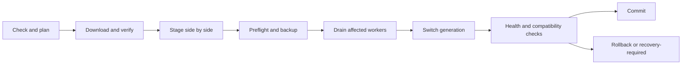

# Service operations, online updates and storage administration

[简体中文](operations.zh-CN.md) · [Documentation](README.md) · [Architecture](architecture.md)

Status: planned. Multi-process isolation, online updates and disk/RAID management are product requirements. This document describes their boundaries and acceptance gates; no live services or disks are changed by this plan.

## 1. Failure recovery

Use the process ownership model in the architecture. Each process reports version, generation, readiness, health, dependency status and last failure. The supervisor restarts only the failed process with bounded exponential backoff and a crash-loop limit. A heartbeat timeout triggers diagnosis and fencing, not a second writer while the first process may still be alive. Apply per-process CPU/memory/handle budgets using tested host mechanisms.

The OS service configuration must allow the intended supervisor-recovery behavior. Verify child adoption on Linux and Windows instead of assuming a supervisor restart preserves children automatically. Match process identity with a boot nonce, generation and authenticated control channel, not PID alone. Explicit full-service stop drains the dependency graph in order; it is different from an accidental supervisor crash.

| Failure | Intended behavior |
| --- | --- |
| One protocol worker crashes | Its connections fail/recover; other protocols, API and monitoring stay up |
| Management API restarts | File traffic continues independently; browser reconnects and reloads jobs |
| Identity service fails | Deny new authentication; existing grants remain valid only until their bounded expiry |
| One storage-domain worker fails | Fence its handles/writes; clients of that domain recover, unrelated domains remain available |
| Monitoring/plugin fails | Mark its data or integration unavailable; preserve file service |
| Update worker fails | Resume the journaled update or retain the active version; do not infer success |
| Storage-admin worker fails | Query native operation state before resuming; a kernel rebuild may still be running |

The shared identity service and each domain's file service remain dependencies. Process isolation limits failure propagation; it does not provide cluster failover or immunity to host-wide failures.

## 2. Online update model

“Online update” means checking, downloading, validating and applying updates through the API/CLI and later WebPanel while preserving unrelated services where possible. It does not mean arbitrary live code replacement or guaranteed uninterrupted SMB/NFS sessions. Each update plan lists affected components, expected disconnects, downtime, restart/reboot needs and rollback support before execution.

The proposed release manifest includes release ID, component versions, OS/architecture, hashes, signatures, compatible API/IPC ranges, schema versions, dependencies and minimum updater version. Verify trusted signing keys, manifest freshness and package identity; reject unsigned, corrupted or unexpected downgrade packages. Key rotation and explicit recovery downgrade policy require tested procedures. Offer an offline package import with the same verification. Default to notifying about updates; installation requires an administrator action or an explicitly configured maintenance policy.

Persist every transition and artifact identity in the updater's own local journal, outside replaceable application directories. Keep the prior version until the new generation passes health checks and the rollback retention period expires. Downloads/staging never replace running binaries. On Windows, side-by-side version directories also avoid relying on overwriting executable files in use. The installation layout and OS service paths must select a verified active version through a recoverable launcher.

### Switching and compatibility

- Drain one independent component at a time when the manifest permits mixed versions. Verify the supported N/N−1 IPC window; this is a target contract to implement and test, not an assumed property.
- Stop new sessions on the affected listener, wait for bounded completion, then disconnect remaining clients only as disclosed in the update plan. Initial updates may briefly release/rebind a port; transparent socket/session handoff is a later capability.
- File-service replacement requires an exclusive domain fence, completed/recorded pending I/O, flushed recovery state and invalidated or explicitly recovered handles. Never serve old and new writers concurrently.
- Identity updates require bounded grant leases and a documented authentication interruption. Revoke or expire stale policy snapshots consistently.
- Schema migrations are owned by the service owning that database. Prefer additive expand/contract migrations for compatible releases. An irreversible migration requires a maintenance window and a recovery plan; do not launch an older binary against a newer incompatible schema.
- Automatic rollback is allowed only before incompatible state/new writes make it unsafe. Restoring an old metadata snapshot after new file writes is not a safe generic rollback. Otherwise stop the affected component and report `recovery_required` with an explicit repair path.
- Update the supervisor/helper through a minimal installer or OS-service handoff. Fence ownership during handoff and test crash/power-loss recovery. A necessary restart is reported; the updater must not depend on the component it has just stopped for its only recovery record.
- Keep frontend assets versioned and API compatibility declared. An open browser should receive a refresh-required notice, preserve drafts where safe, and reconnect to server-side jobs.

Initial update scope covers tauCloud binaries, bundled dependencies and frontend assets. Plugins use their versioned lifecycle. Host OS/kernel/driver updates, Docker image updates and RAID metadata-format upgrades are separate operations, never silently bundled into a tauCloud update.

## 3. Disk and RAID provider strategy

Manage native storage rather than implementing RAID parity, a block driver or an on-disk format in tauCloud. Keep physical disk, partition, array/pool, virtual disk, filesystem, mount, storage root and user space as distinct resources. A user `Space` is not a RAID pool. Read-only inventory of existing storage does not authorize its modification or adoption.

| Provider | Planned scope | Capability boundary |
| --- | --- | --- |
| Linux MD via validated mdadm/OS adapters | Inventory/import, create, member replacement, rebuild/check and supported growth | RAID1 first; RAID0/10/5/6 individually gated; filesystem resize is a separate step |
| Windows Storage Spaces via supported storage APIs/providers | Pools, virtual disks, physical members, health, repair and supported growth | Mirror first; simple/parity gated by OS edition, topology and provider support |
| Filesystem/volume adapters | Approved partition/filesystem creation, mount and supported expansion | ext4 on Linux and NTFS on Windows first; no blanket shrink or online-resize guarantee |
| Hardware RAID controllers | Inventory when available | Configuration needs a separately tested vendor adapter; no generic hardware-RAID promise |

Linux MD provides the native array substrate; Windows Storage Spaces exposes pools and resiliency layouts, which are not a one-to-one translation of Linux RAID levels. Keep native names and capabilities visible rather than relabeling every layout as “RAID5”. [Linux MD documentation](https://docs.kernel.org/admin-guide/md.html), [Windows Storage Spaces](https://support.microsoft.com/en-us/windows/experience/storage-filemanagement/storage-spaces-in-windows)

Use typed privileged requests and fixed executable/argument templates where a maintained tool is necessary. The helper revalidates the plan and device identities at execution time; no shell fragments supplied by a browser or plugin. Native RAID management does not change the native file-protocol implementation goal.

## 4. Storage operations and data protection

Initial management scope includes inventory/topology, health/capacity, importing supported arrays, creating a supported layout on explicitly selected unused disks, replace/rebuild, scrub/check and validated expansion. Destruction, partition changes and formatting are available only through an explicit preview/confirm workflow for supported providers. Do not automatically convert existing data disks or assume an in-place migration is safe.

1. Discover stable disk serial/WWN/provider IDs, sizes, sector geometry, partitions, mounts, existing signatures and active consumers. Protect boot/system/swap/pagefile, tauCloud state and updater locations. Refuse mutation when identity or use cannot be established.
2. Produce a short-lived plan tied to topology revision and exact stable device identities. Show affected volumes/shares/containers, erasure scope, usable capacity assumptions, redundancy, prerequisites, estimated interruption and whether cancellation is possible. RAID is not a backup.
3. Require an authorized administrator to confirm the actual plan and destructive targets. Bind confirmation to the plan digest and operation, reauthenticate for destructive actions, and invalidate approval after topology drift.
4. Serialize conflicting mutations. Drain dependent file workers, quiesce affected shares and verify other mount/container/host users; refuse if safe exclusive access cannot be established. Keep only affected resources in maintenance mode.
5. Persist intent before submitting native work. Track array generation, native operation ID, progress, errors and irreversible boundaries. Reconcile after daemon/host restart; do not repeat “create”, “format” or “remove member” on a timeout.
6. Verify resulting topology, health, capacity and mounts before exposing storage roots or resuming shares. Record partial success and recovery instructions when later steps fail. Cancellation stops only at provider-supported safe points; cancelling the UI job does not necessarily stop a kernel rebuild.

Existing degraded/foreign arrays are discovered without forced assembly or metadata overwrite. Import uses an explicit provider-aware procedure and is refused when the safety conditions are unknown. Expansion is an ordered array/virtual-disk → partition → filesystem workflow only where each layer supports it; never call shrinking a rollback of expansion. Disk removal requires provider-confirmed evacuation/redundancy safety.

Storage changes and software updates share a maintenance lock for overlapping resources. Block incompatible upgrades during migration, reshape, firmware activity or an unrecoverable degraded condition. A healthy native rebuild need not prevent unrelated component updates, but its owning controller must remain recoverable.

## 5. APIs and acceptance

Expose `/api/v1/services`, `/updates`, `/storage-pools`, `/arrays`, `/volumes` and `/storage-plans` (all with the same prefix), backed by durable jobs. Plans are previews; a separate authorized execution call starts work. Enforce expected revisions and idempotency keys. Jobs survive browser closure and API restart, and include affected resources, phase, progress, cancellability and recovery state.

M1/M2 require process isolation, IPC/version negotiation, fencing and failure tests. M8b delivers disk/RAID administration; M8c delivers verified online updates. Validate on disposable VMs/virtual disks first, then representative hardware before claiming hardware behavior. Required tests include killing each worker, hung dependencies, IPC overload, lease expiry, interrupted update at every transition, signature failure, version skew, failed rollback, member loss, replacement/rebuild, disk identity changes and restart during storage work. Demonstrate that an unrelated protocol and volume continue serving during a scoped fault/update.
