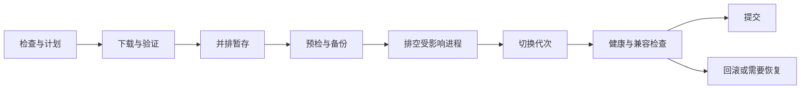

# 服务运维、在线升级与存储管理

[English](operations.md) · [文档](README.zh-CN.md) · [架构](architecture.zh-CN.md)

状态：规划中。多进程隔离、在线升级和硬盘/RAID 管理是产品要求。本文定义边界与验收条件，本次规划不修改任何实际服务或磁盘。

## 1. 故障恢复

遵循架构中的进程所有权模型。每个进程报告版本、代次、就绪、健康、依赖状态和最近故障。监督器只重启失败进程，采用有界指数退避与崩溃循环上限。心跳超时应触发诊断和隔离，不能在原进程可能仍存活时启动第二个写入者。通过经过测试的宿主机制限制每进程 CPU、内存与句柄资源。

操作系统服务配置必须允许预期的监督器恢复行为。分别验证 Linux/Windows 子进程接管，不能假设监督器重启会自动保留子进程。通过启动随机标识、代次与认证控制通道匹配进程身份，而非仅凭 PID。显式停止全部服务时按依赖顺序排空，这与监督器意外崩溃不同。

| 故障 | 预期行为 |
| --- | --- |
| 单个协议进程崩溃 | 对应连接失败或恢复，其他协议、API 与监控继续运行 |
| 管理 API 重启 | 文件流量独立继续，浏览器重连并重新读取任务 |
| 身份服务失败 | 拒绝新认证；已有授权仅在有界有效期内有效 |
| 单个存储域文件进程失败 | 隔离句柄和写入，该域客户端恢复，其他域仍可用 |
| 监控或插件失败 | 对应数据或集成标为不可用，保留文件服务 |
| 升级进程失败 | 按日志继续升级或保留当前版本，不能推断为成功 |
| 存储管理进程失败 | 查询原生操作状态再继续，内核重建可能仍在运行 |

共享身份服务和各域文件服务仍是依赖。进程隔离限制故障传播，不提供集群切换，也不能抵御宿主整体故障。

## 2. 在线升级模型

“在线升级”指通过 API/CLI 以及后续 WebPanel 检查、下载、验证和应用更新，并尽可能保留无关服务。它不代表任意代码热替换，也不保证 SMB/NFS 会话永不中断。每个升级计划执行前列出影响组件、预期断线、停机时间、服务或系统重启需求，以及是否支持回滚。

建议发布清单包含发布 ID、组件版本、操作系统与架构、摘要、签名、兼容 API/IPC 范围、schema 版本、依赖和最低升级器版本。验证可信签名密钥、清单时效与包身份，拒绝未签名、损坏或非预期降级包。密钥轮换和显式恢复降级策略必须经过测试。离线包导入使用相同校验。默认通知更新；安装需管理员操作，或由显式配置的维护策略授权。

每个状态转换和制品身份写入升级器自己的本地日志，位于可替换应用目录之外。新代次通过健康检查且回滚保留期结束前保留旧版本。下载和暂存不替换运行中的程序。Windows 上使用并排版本目录，也避免依赖覆盖正在使用的可执行文件。安装布局与系统服务路径通过可恢复启动器选择已验证的活动版本。

### 切换与兼容性

- 只有清单允许混合版本时，才逐个排空独立组件。验证受支持的 N/N−1 IPC 窗口，这是待实现并测试的目标契约，不能默认存在。
- 受影响监听器停止接受新会话，等待有界完成，然后只按升级计划中说明的方式断开剩余客户端。初期允许短暂释放并重新绑定端口，透明套接字或会话移交作为后续能力。
- 文件服务替换需要独占存储域隔离、完成或记录未决 I/O、刷写恢复状态，并使句柄失效或显式恢复。新旧写入者不能并存。
- 身份服务升级需要有界授权租约和明确的认证中断说明，一致地撤销或过期旧策略快照。
- 数据库迁移由其所有者执行。兼容版本优先采用增量扩展再收缩的迁移方式。不可逆迁移需要维护窗口与恢复计划，不能让旧程序读取不兼容新 schema。
- 仅在不兼容状态或新写入尚未使回退不安全时自动回滚。产生新文件写入后恢复旧元数据快照，不是通用安全回滚。无法自动回滚时停止受影响组件，报告 `recovery_required` 和明确修复路径。
- 监督器与辅助服务通过最小安装器或系统服务移交更新。移交期间隔离所有权，验证崩溃与掉电恢复。需要重启时明确报告；升级器唯一恢复记录不能依赖刚刚被自己停掉的组件。
- 前端资源版本化，并声明 API 兼容性。已打开浏览器收到需要刷新提示，安全时保留草稿，并重新连接服务端任务。

初始升级范围包含 tauCloud 程序、随包依赖和前端资源。插件使用自己的版本化生命周期。宿主系统、内核、驱动更新，Docker 镜像更新以及 RAID 元数据格式升级属于独立操作，不能静默混入 tauCloud 更新。

## 3. 硬盘与 RAID 提供者策略

管理原生存储，不在 tauCloud 中自研 RAID 校验、块驱动或磁盘格式。物理磁盘、分区、阵列/池、虚拟磁盘、文件系统、挂载、存储根与用户空间是不同资源。用户 `Space` 不等于 RAID 存储池。只读发现已有存储不代表授权修改或接管它。

| 提供者 | 计划范围 | 能力边界 |
| --- | --- | --- |
| Linux MD，通过验证的 mdadm/系统适配器 | 清单/导入、创建、成员替换、重建/检查和受支持扩容 | 优先 RAID1；RAID0/10/5/6 分别验收；文件系统扩容为独立步骤 |
| Windows Storage Spaces，通过受支持存储 API/提供者 | 存储池、虚拟磁盘、物理成员、健康、修复与受支持扩容 | 优先镜像；simple/parity 按系统版本、拓扑与提供者能力验收 |
| 文件系统/卷适配器 | 已批准的分区/文件系统创建、挂载和受支持扩容 | Linux 优先 ext4，Windows 优先 NTFS；不统一承诺缩容或在线扩容 |
| 硬件 RAID 控制器 | 可获取时提供清单 | 配置需要单独测试的厂商适配器，不承诺通用硬件 RAID 管理 |

Linux MD 提供原生阵列基础，Windows Storage Spaces 提供存储池与弹性布局，两者不能按 RAID 等级一一对应。保留原生名称与能力，不能将所有布局都改名为“RAID5”。[Linux MD 文档](https://docs.kernel.org/admin-guide/md.html)、[Windows Storage Spaces](https://support.microsoft.com/en-us/windows/experience/storage-filemanagement/storage-spaces-in-windows)

使用类型化特权请求；需要成熟工具时，固定程序和参数模板。辅助服务执行时重新验证计划与设备身份，不接受浏览器或插件提供的 Shell 片段。管理原生 RAID 不改变文件协议服务器尽量自研的目标。

## 4. 存储操作与数据保护

初期管理范围包括清单拓扑、健康与容量、导入受支持阵列、在显式选定的空闲磁盘上创建已支持布局、替换与重建、scrub/check，以及经过验证的扩容。销毁、分区修改和格式化仅通过受支持提供者的显式预览与确认流程开放。不自动转换已有数据盘，也不假定原地迁移一定安全。

1. 发现稳定磁盘序列号、WWN 或提供者 ID、容量、扇区几何、分区、挂载、已有签名和活动使用者。保护启动盘、系统盘、swap/pagefile、tauCloud 状态与升级器位置。无法确定身份或使用情况时拒绝变更。
2. 生成短期有效、绑定拓扑修订号与准确设备身份的计划。展示受影响的卷、共享和容器，清除范围、可用容量假设、冗余、前提、预计中断与是否可取消。RAID 不代替备份。
3. 要求已授权管理员确认具体计划及破坏性目标。确认绑定计划摘要和操作，破坏性动作重新认证；拓扑变化后原确认失效。
4. 冲突变更串行化。排空依赖文件进程，暂停相关共享，核实其他挂载、容器与宿主使用者。不能建立安全独占访问时拒绝操作；仅相关资源进入维护模式。
5. 提交原生任务前持久化意图。跟踪阵列代次、原生操作 ID、进度、错误和不可逆边界。服务或宿主重启后协调恢复，不能因超时重复执行创建、格式化或移除成员。
6. 验证最终拓扑、健康、容量与挂载后再暴露存储根或恢复共享。后续步骤失败时记录部分成功与恢复说明。只有提供者支持的安全点才能取消，取消界面任务不一定能停止内核重建。

发现已有降级或外来阵列时，不强制组装或覆盖元数据。导入采用理解提供者语义的显式流程，安全条件未知时拒绝。扩容按阵列/虚拟盘 → 分区 → 文件系统逐层进行，且每层都必须支持；不能把缩容称为扩容回滚。移除磁盘前，提供者必须确认数据迁移或冗余安全。

存储变更与软件升级对重叠资源共享维护锁。迁移、reshape、固件活动或不可恢复的降级状态期间阻止不兼容升级。健康的原生重建未必阻塞无关组件更新，但管理它的控制组件必须保持可恢复。

## 5. API 与验收

提供 `/api/v1/services`、`/updates`、`/storage-pools`、`/arrays`、`/volumes` 和 `/storage-plans`（均使用同一前缀），底层为持久化任务。计划只是预览，通过另一个已授权执行调用启动。强制修订号前置条件与幂等键。任务不因浏览器关闭或 API 重启消失，包含影响资源、阶段、进度、可取消性和恢复状态。

M1/M2 要求进程隔离、IPC/版本协商、代次隔离与故障测试。M8b 交付硬盘/RAID 管理，M8c 交付经过验证的在线升级。先在可丢弃虚拟机和虚拟磁盘上测试，验证代表性硬件后再声明硬件行为。必测项包括逐个杀死工作进程、依赖卡死、IPC 过载、租约到期、各状态升级中断、签名失败、版本不匹配、回滚失败、成员丢失、替换重建、磁盘身份变化和存储操作中重启。演示局部故障或升级期间，无关协议和卷仍能提供服务。
