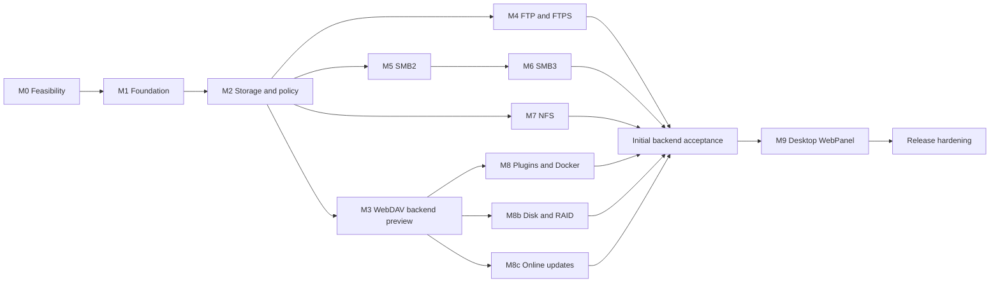

# Implementation roadmap

[简体中文](roadmap.zh-CN.md) · [Documentation](README.md) · [Task checklist](../TODO.md)

Status: M0 experiments implemented; [standard-port Windows SMB deployment remains open](m0.md). Later milestones are planned. Milestone numbers describe delivery gates, not promised dates. Native SMB and NFS remain substantial workstreams.

## 1. Delivery strategy

Deliver a usable backend before the full protocol suite. The first backend preview is M1–M3: management API/CLI, users and spaces, safe file operations, basic monitoring and WebDAV on Linux and Windows. This preview must explicitly identify missing protocols and is not the completed NAS feature set.

M4–M7 add independently validated protocol profiles. M8 covers plugins/Docker, M8b disk/RAID management and M8c online updates; they build on core contracts after M3. Process isolation is required from M1, not postponed to the plugin milestone. M9 begins after acceptance of the selected initial backend scope and its APIs, including the chosen M4–M8c deliverables. Optional later extensions need not block it. A complete initial product requires that backend scope, the WebPanel and release hardening.

The graph shows dependencies, not a staffing commitment. With one primary developer, finish M3 before splitting attention; then prioritize the protocol most needed by real clients. Preserve the native implementation goal if a protocol takes longer, and release a clearly scoped subset instead of silently substituting a system-service backend.

## 2. Milestones and exit criteria

| Milestone | Deliverable | Exit gate |
| --- | --- | --- |
| **M0 — Feasibility and decisions** | Pinned toolchain/PACE baseline; streaming, process/IPC recovery, filesystem and Windows SMB experiments | Recorded decisions and reproducible evidence on both hosts; no unresolved assumption hidden in the first release scope |
| **M1 — Backend foundation** | xmake process targets, supervisor/CLI, authenticated versioned IPC, config, logging, per-owner metadata, TLS API, bootstrap and sessions | Clean checkout builds on Linux/Windows; CLI authenticates; supervisor adopts/restarts verified workers; sibling services survive a worker crash; no frontend dependency |
| **M2 — Shared file core** | Users/groups, roots/spaces/shares, scoped grants, per-domain file workers, quota/lock authority, durable jobs and separate monitoring | Isolation and path-race tests pass; >RAM files remain bounded; interrupted writes/restarts recover; capabilities reflect host limits |
| **M3 — WebDAV and backend preview** | Streaming HTTP, tested WebDAV profile, OpenAPI and administration CLI coverage | Independent DAV clients pass; quotas and permissions hold; no whole-file buffering; backup/restore and host telemetry demonstrated |
| **M4 — FTP/FTPS** | Isolated passive FTP/explicit FTPS server | Client matrix passes on both hosts; protected control/data channels, cancellation, credential revocation and worker recovery verified |
| **M5 — SMB2** | Signed SMB 2.1; explicitly enabled 2.0.2 compatibility | Windows/Linux/macOS client matrix; auth, signing, share modes, locking and file semantics pass; deployment conflicts documented |
| **M6 — SMB3** | Individually tested 3.0, 3.0.2 and 3.1.1 profiles | Correct negotiation, signing, encryption, preauthentication integrity and downgrade rejection; optional capabilities advertised honestly |
| **M7a — NFSv4.1** | TCP RPC/XDR, v4.1 server, export policy and trusted-network AUTH_SYS profile | Applicable conformance cases, stable handles, replay, reboot/reclaim and write durability pass on both server hosts |
| **M7b — NFSv3 compatibility** | v3 operations, discovery/mount, locking/recovery profile | Actual target clients pass including retransmit, stale handles and COMMIT; unavailable optional transports/features documented |
| **M8 — Plugins and Docker** | Versioned plugin IPC/lifecycle; Docker inventory and authorized lifecycle actions | Crash containment, permissions and upgrade/rollback pass; Unix socket/Windows pipe or approved TLS works; missing engines handled |
| **M8b — Disk and RAID management** | Native-provider topology, import/create, replace/rebuild, check and supported growth | Disposable-disk tests pass for plans, authorization, stable identities, restart/reconcile, partial failures and preservation of unrelated storage |
| **M8c — Online updates** | Signed component packages, staging, compatibility plans, draining, switch and recovery | Interrupted updates, corrupted signatures, version skew, guarded rollback and supervisor handoff pass; unrelated services continue where declared |
| **M9 — Desktop WebPanel** | Independent desktop shell, launcher/taskbar/windows and apps for files, settings, storage, monitoring, updates, plugins and Docker | Public APIs only; keyboard/responsive behavior, capability controls, session expiry, job persistence and update reconnect pass |
| **Release hardening** | Installers/packages, recovery guide, support matrix and operational defaults | Full selected host/client suite, security review, upgrade/restore drills and published limitations |

M7a's AUTH_SYS profile is explicitly a trusted-network offering. RPCSEC_GSS/Kerberos is required before claiming authenticated NFS access across untrusted clients; neither that profile nor AD integration is implied by the first preview. No milestone is complete merely because negotiation or mounting succeeds.

## 3. M0 experiments that unblock implementation

1. **Build baseline:** select a clean PACE commit, exact xmake/compiler/SDK versions and CI images. Check component inclusion and options without relying on the adjacent checkout's uncommitted changes.
2. **File execution bridge:** prove bounded blocking jobs, PACE context handoff, cancellation and shutdown with slow disks on Linux and Windows. Define per-connection and global memory budgets.
3. **HTTP streaming:** design incremental uploads and asynchronous download producers, including authentication before body acceptance and `100-continue`. Record upstream PACE changes versus local adapters.
4. **Filesystem semantics:** prototype root confinement, stable IDs, rename/delete while open, case behavior and flush durability on ext4/NTFS. Decide which native primitives are mandatory.
5. **Process isolation:** demonstrate worker kill/restart, supervisor adoption, generation fencing, bounded IPC and policy-lease expiry. Verify sibling traffic survives a scoped failure.
6. **SMB feasibility:** run a minimal negotiate/authenticate/signed-open experiment; validate local-account credential provisioning and functional interoperability on an available loopback port; record Windows TCP 445 coexistence limits. This remains a prototype, not SMB support.
7. **NFS state design:** document stable handle persistence, replay/reclaim storage and UID/GID mapping before implementing the wire surface broadly.
8. **Integration transports:** establish how local IPC, Docker Unix sockets and Windows named pipes integrate with PACE scheduling without blocking it.
9. **Storage and updates:** select native storage providers and reversible test fixtures; prototype side-by-side packages, durable update journals and mixed-version compatibility. Define destructive-plan authorization and migration rollback boundaries.

The [M0 experiment suite](m0.md) implements these prototypes and records bounded evidence from disposable fixtures. The user accepted its functional scope without requiring port 445; passing a prototype does not enable a production protocol profile. M1 local management is implemented; see the [M1 guide](m1.md).

## 4. Acceptance scenarios

Every backend preview must demonstrate the following through API/CLI or independent clients, without a WebPanel:

- Bootstrap an administrator, create two users and a group, register a root, create private/team spaces and grant a shared subtree.
- Prove one user cannot enumerate or open the other's private files through any enabled protocol, including after a rename or permission change.
- Transfer a file larger than available memory with configured concurrency; measure memory bounds and avoid blocking unrelated management requests.
- Fill a quota and a disposable volume; verify accurate errors, cleanup and accounting with concurrent writes.
- Restart during upload, configuration update and a queued job; reconcile state without falsely reporting success or deleting unrelated files.
- Show CPU/memory/network/capacity data and correctly distinguish healthy, stale, unavailable and permission-denied disk collectors.
- Back up metadata, restore to a test instance, and explain which file data and secrets require separate restoration.
- Install, stop, restart and uninstall the service without removing user file data.
- Kill each protocol/monitoring worker and prove unrelated traffic continues; exercise storage-domain and identity-authority degradation without stale-generation access.

M8b additionally demonstrates disk-plan drift rejection, member replacement/rebuild and restart reconciliation on disposable storage. M8c demonstrates component upgrades, failed health checks and recovery at every switch boundary, with declared service interruption.

Protocol milestones add their [specific interoperability gates](protocols.md). Cross-protocol write access stays restricted until lock, cache, revocation and durability tests demonstrate safe behavior for that exact combination.

## 5. Quality and performance gates

CI begins on Linux/GCC, Linux/Clang and Windows/MSVC. Separate unit tests, real-filesystem integration, protocol interoperability, malformed-input fuzzing and recovery tests. Use disposable directories/volumes; never target a developer's real NAS data. Store client/OS/tool versions alongside results.

Record throughput, request latency, CPU, memory, concurrent clients and recovery times under controlled workloads. Include small-file metadata, sequential transfer, random I/O and slow-client cases, with and without protocol encryption. Define numerical budgets in M0 from reference hardware; do not invent throughput targets without storage/network measurements.

Release evidence covers upgrade compatibility, rollback limitations, dependency inventories, configuration export/import and failures under disk pressure. English and Chinese design pages must change together; supported-feature claims must agree with the test matrix.

## 6. Deferred scope

Disk/RAID management and online updates are included in M8b/M8c. The first product does not include an OS image, a custom filesystem/RAID engine, unrequested disk formatting, distributed metadata, clustering/HA, object storage, transparent remote-drive mounting, a public plugin marketplace, mobile/desktop sync clients, photo/media applications, or public relay service. Native snapshots, recycle bins, scheduled file-data backup, rich ACL translation, MFA/OIDC and Kerberos are follow-on designs with separate acceptance criteria.

Commercial NAS parity is a long-term product direction. Reliability and compatibility of the selected features take precedence over claiming an appliance-sized checklist in the first release.

## 7. Decision register

| Decision | Current position | Resolve by |
| --- | --- | --- |
| C++20 / xmake / PACE | Established direction | M0 pins versions |
| Native protocol servers | Established direction; mature crypto/auth primitives allowed | Per-layer library choices in M0 |
| Windows and Linux | Both required; x86-64 first | M0 exact host/toolchain matrix |
| Frontend interaction | Desktop shell with application windows, taskbar and notifications; framework open | M9 |
| Metadata persistence | SQLite proposed | M1 migration/recovery prototype |
| Process topology | Supervised separate services with per-domain storage authority | M0/M1 |
| Online upgrades | Verified component updates, bounded draining and guarded rollback | M8c |
| SMB authentication/secrets | Local NTLMv2 profile plus separate credential enrollment | M0/M5 security and interoperability review |
| NFS versions | v4.1 primary, v3 later; Kerberos deferred | M7 profile gates |
| Cross-protocol writable shares | Restricted until semantic tests pass | Each protocol milestone |
| Plugin transport and sandbox | Versioned process IPC; trusted-only until confinement proven | M8, with IPC groundwork in M0 |
| Host storage administration | Native Linux MD / Windows Storage Spaces adapters; explicit destructive plans | M8b |

Record changed decisions in `docs/decisions/` when implementation begins, with matching English/Chinese summaries. Keep the rationale, alternatives, consequences and validation evidence; do not let an untested experiment quietly become a permanent contract.
