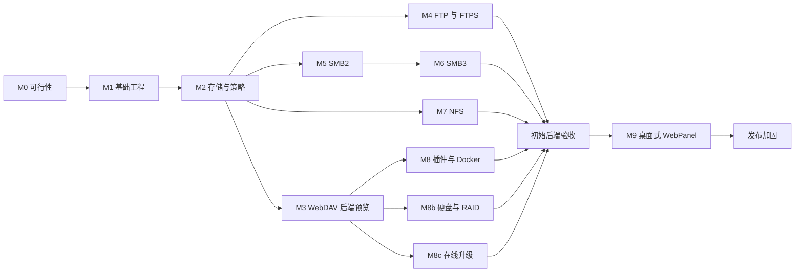

# 实施路线图

[English](roadmap.md) · [文档](README.zh-CN.md) · [任务清单](../TODO.md)

状态：M0 实验已实现，[Windows 标准端口 SMB 部署仍未验收](m0.zh-CN.md)，后续里程碑仍在规划中。里程碑编号表示交付门槛，不代表承诺日期；原生 SMB 和 NFS 仍是较大的工程。

## 1. 交付策略

先交付可用后端，再补齐全部协议。首个后端预览为 M1–M3：在 Linux 与 Windows 上提供管理 API/CLI、用户与空间、安全文件操作、基础监控和 WebDAV。该预览必须明确缺失协议，不代表 NAS 功能已经完成。

M4–M7 增加独立验证的协议配置。M8 覆盖插件/Docker，M8b 覆盖硬盘/RAID 管理，M8c 覆盖在线升级，均在 M3 后基于核心契约推进。进程隔离从 M1 开始，不能推迟至插件阶段。M9 在选定的初始后端范围及 API 通过验收后开始，包括选定的 M4–M8c 交付项；后续可选扩展不必阻塞它。完整初始产品需要这些后端能力、WebPanel 和发布加固。

图表示依赖关系，不代表人员安排。如果主要由一人开发，建议完成 M3 后再分散精力，随后根据真实客户端需求确定协议优先级。某协议耗时较长时，保留自研方向，发布范围明确的子集，不能静默替换成系统服务后端。

## 2. 里程碑与验收标准

| 里程碑 | 交付内容 | 完成门槛 |
| --- | --- | --- |
| **M0 — 可行性与决策** | 固定工具链与 PACE 基线；流式、进程/IPC 恢复、文件系统和 Windows SMB 实验 | 两种宿主均有可复现依据与决策记录，首版范围不隐藏未解决假设 |
| **M1 — 后端基础** | xmake 进程目标、监督器/CLI、认证版本化 IPC、配置、日志、分所有者元数据、TLS API、初始化与会话 | 干净检出在 Linux/Windows 编译；CLI 认证；监督器验证接管与重启；单进程崩溃不影响其他服务；无前端依赖 |
| **M2 — 共享文件核心** | 用户组、根/空间/共享、限定授权、分域文件进程、配额与锁权威状态、持久化任务与独立监控 | 隔离与路径竞态测试通过；大于内存的文件资源有界；中断与重启可恢复；能力反映宿主限制 |
| **M3 — WebDAV 与后端预览** | 流式 HTTP、经过验证的 WebDAV 配置、OpenAPI 与管理 CLI 覆盖 | 独立 DAV 客户端通过；权限配额正确；无整文件缓冲；演示备份恢复与宿主遥测 |
| **M4 — FTP/FTPS** | 隔离的被动 FTP/显式 FTPS 服务 | 两种宿主客户端矩阵通过；验证控制/数据加密、取消、凭据撤销与进程恢复 |
| **M5 — SMB2** | 签名 SMB 2.1；显式启用的 2.0.2 兼容 | Windows/Linux/macOS 客户端矩阵；认证、签名、共享模式、锁和文件语义通过；说明部署冲突 |
| **M6 — SMB3** | 分别验证 3.0、3.0.2 和 3.1.1 配置 | 正确协商、签名、加密、预认证完整性与降级拒绝；如实声明可选能力 |
| **M7a — NFSv4.1** | TCP RPC/XDR、v4.1 服务器、导出策略和可信网络 AUTH_SYS 配置 | 两种服务器宿主均通过适用合规用例、稳定句柄、重放、重启/reclaim 和持久写测试 |
| **M7b — NFSv3 兼容** | v3 操作、发现与挂载、锁与恢复配置 | 实际目标客户端通过重传、过期句柄和 COMMIT 等测试；说明不可用传输与特性 |
| **M8 — 插件与 Docker** | 版本化插件 IPC/生命周期；Docker 清单和已授权生命周期动作 | 崩溃隔离、权限、升级回滚通过；Unix socket/Windows 管道或已批准 TLS 可用；正确处理引擎缺失 |
| **M8b — 硬盘与 RAID 管理** | 原生提供者拓扑、导入创建、替换重建、检查和受支持扩容 | 可丢弃磁盘验证计划、授权、稳定身份、重启协调、部分失败与无关存储保护 |
| **M8c — 在线升级** | 签名组件包、暂存、兼容计划、排空、切换与恢复 | 升级中断、签名损坏、版本不匹配、受约束回滚和监督器移交通过；按声明保留无关服务 |
| **M9 — 桌面式 WebPanel** | 独立桌面壳、启动器/任务栏/窗口，以及文件、设置、存储、监控、更新、插件和 Docker 应用 | 仅公开 API；键盘与响应式、能力控件、会话过期、任务持久化与升级重连通过 |
| **发布加固** | 安装包、恢复指南、支持矩阵与运行默认值 | 选定宿主/客户端完整测试、安全评审、升级恢复演练和公开限制 |

M7a 的 AUTH_SYS 明确限定在可信网络。对不可信客户端宣称经过认证的 NFS 访问前，需要 RPCSEC_GSS/Kerberos；首个预览不隐含提供该配置或 AD 集成。仅能协商或挂载不能算完成里程碑。

## 3. M0 解锁实施的实验

1. **构建基线：**选择干净 PACE 提交、具体 xmake/编译器/SDK 和 CI 镜像，验证组件引入与选项，不依赖相邻仓库的未提交变更。
2. **文件执行桥接：**在 Linux/Windows 慢磁盘条件下验证有界阻塞任务、PACE 上下文回传、取消和退出，定义单连接与全局内存预算。
3. **HTTP 流式：**设计增量上传和异步下载生产者，包含请求体准入前认证与 `100-continue`，记录哪些改动进入 PACE、哪些属于本地适配。
4. **文件系统语义：**在 ext4/NTFS 上验证根约束、稳定 ID、打开期间重命名或删除、大小写和刷写持久性，确定必须依赖的原生操作。
5. **进程隔离：**演示进程退出重启、监督器接管、代次隔离、有界 IPC 与策略租约到期，验证局部故障期间其他流量继续。
6. **SMB 可行性：**完成最小协商、认证和签名打开实验，验证本地账户凭据注册和可用回环端口上的功能互操作，记录 Windows TCP 445 共存限制。这仍然是原型，不是 SMB 支持。
7. **NFS 状态设计：**大规模实现协议之前，先确定稳定句柄持久化、重放或 reclaim 存储以及 UID/GID 映射。
8. **集成传输：**明确本地 IPC、Docker Unix socket 和 Windows 命名管道如何接入 PACE 调度且不阻塞事件循环。
9. **存储与升级：**选择原生存储提供者和可恢复测试环境，验证并排包、持久化升级日志与混合版本兼容，定义破坏性计划授权与迁移回滚边界。

[M0 实验套件](m0.zh-CN.md)已实现这些原型，并记录可丢弃夹具上的有限验证依据。用户已接受其功能证据，无须占用 445；原型通过不等于启用生产协议配置。M1 本地管理已实现，见 [M1 指南](m1.zh-CN.md)。

## 4. 验收场景

每个后端预览必须通过 API/CLI 或独立客户端完成以下演示，不依赖 WebPanel：

- 初始化管理员，创建两个用户和一个组，注册存储根，创建私人和团队空间，并授权共享子树。
- 验证用户无法通过任一已启用协议枚举或打开另一用户的私有文件，包括重命名或权限变更后。
- 以配置并发传输大于可用内存的文件，测量内存上界，并保证不阻塞无关管理请求。
- 耗尽配额和可丢弃测试卷，验证并发写入下的错误、清理和记账。
- 在上传、配置更新和排队任务期间重启，协调状态，不能错误报告成功或删除无关文件。
- 显示 CPU、内存、网络与容量数据，正确区分健康、过期、不可用和权限不足的磁盘采集状态。
- 备份元数据并恢复到测试实例，说明哪些文件内容与秘密需要单独恢复。
- 安装、停止、重启与卸载服务，保留用户文件数据。
- 逐个杀死协议/监控工作进程，证明无关流量继续；验证存储域和身份服务降级，拒绝旧代次访问。

M8b 另需在可丢弃存储上演示磁盘计划漂移拒绝、成员替换重建和重启协调。M8c 另需演示组件更新、健康检查失败与每个切换边界的恢复，并声明服务中断范围。

协议里程碑增加各自[互操作门槛](protocols.zh-CN.md)。跨协议可写在对应组合的锁、缓存、撤销和持久性测试通过前保持受限。

## 5. 质量与性能门槛

CI 从 Linux/GCC、Linux/Clang 和 Windows/MSVC 开始，区分单元测试、真实文件系统集成、协议互操作、畸形输入 fuzz 与恢复测试。使用可丢弃目录或卷，不能操作开发者的真实 NAS 数据。结果中记录客户端、系统和工具版本。

在受控负载下记录吞吐、请求延迟、CPU、内存、并发客户端和恢复时间。包含小文件元数据、顺序传输、随机 I/O 与慢客户端，分别测量协议加密开关。M0 根据参考硬件确定数值预算；未测量存储和网络前不编造吞吐目标。

发布依据覆盖升级兼容、回滚限制、依赖清单、配置导入导出和磁盘压力下失败。英文与中文版设计同步修改，功能支持声明必须与测试矩阵一致。

## 6. 延后范围

硬盘/RAID 管理与在线升级纳入 M8b/M8c。首个产品不包含操作系统镜像、自研文件系统/RAID 引擎、未经请求的磁盘格式化、分布式元数据、集群/高可用、对象存储、透明远程盘挂载、公开插件市场、手机或桌面同步客户端、相册媒体应用与公共中继。原生快照、回收站、定时文件数据备份、丰富 ACL 转换、MFA/OIDC 和 Kerberos 是后续独立设计，分别验收。

对标商用 NAS 是长期产品方向。应先保证选定功能的可靠性和兼容性，不能在首版就宣称完成整个商业设备的功能清单。

## 7. 决策登记

| 决策 | 当前方向 | 解决节点 |
| --- | --- | --- |
| C++20 / xmake / PACE | 已确定 | M0 固定版本 |
| 原生协议服务器 | 已确定；允许成熟密码学与认证原语 | M0 决定具体层的库 |
| Windows 与 Linux | 均必须支持，x86-64 优先 | M0 固定系统与工具链矩阵 |
| 前端交互 | 带应用窗口、任务栏与通知的桌面壳；框架待定 | M9 |
| 元数据存储 | 建议 SQLite | M1 迁移恢复原型 |
| 进程拓扑 | 受监督独立服务与分域存储权威状态 | M0/M1 |
| 在线升级 | 验证组件更新、有界排空与受约束回滚 | M8c |
| SMB 认证与秘密 | 本地 NTLMv2 配置、独立凭据注册 | M0/M5 安全与互操作评审 |
| NFS 版本 | 主线 v4.1，后续 v3；Kerberos 延后 | M7 配置验收 |
| 跨协议可写共享 | 语义测试通过前限制 | 各协议里程碑 |
| 插件传输与沙箱 | 版本化进程 IPC，约束验证前仅可信代码 | M8；M0 准备 IPC 基础 |
| 宿主存储管理 | 原生 Linux MD / Windows Storage Spaces 适配，显式破坏性计划 | M8b |

开始实施后，在 `docs/decisions/` 中记录变更决策，并提供对应中英文摘要。保留理由、替代方案、影响和验证依据，不能让未经验证的实验悄悄成为永久契约。
